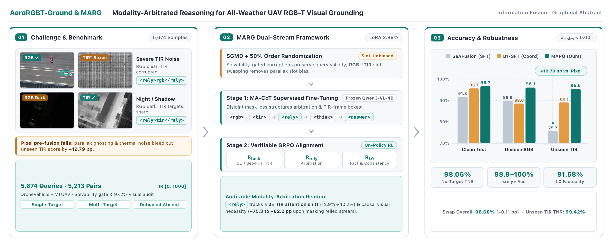
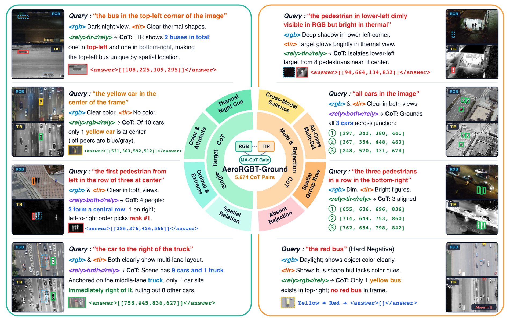
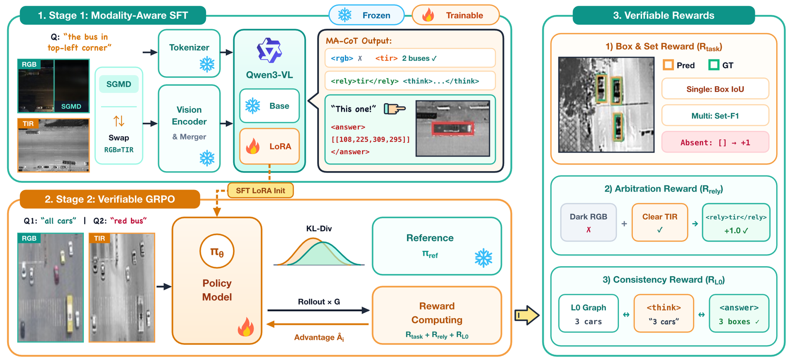

<div align="center">

# AeroRGBT-Ground: A Benchmark and Modality-Arbitrated Fusion Reasoning Framework for UAV Visual Grounding

**Lei Cheng**, **Yangjie Wei\***, **Xinyue Feng**, **Xinyuan Wang**, **Yuqiao Wang**, **Mei Li**, and **Ben Niu**

School of Computer Science and Engineering, Northeastern University, Shenyang 110819, China  
\*Corresponding author: [`weiyangjie@cse.neu.edu.cn`](mailto:weiyangjie@cse.neu.edu.cn)

[-0F766E)](https://github.com/ChengLeiNEU/AeroRGBT-Ground)
[](https://github.com/ChengLeiNEU/AeroRGBT-Ground)
[](https://huggingface.co/Qwen/Qwen3-VL-4B-Instruct)

</div>

---

<p align="center">
  
</p>

## Overview

**AeroRGBT-Ground** is a benchmark for unmanned aerial vehicle (UAV) visible and thermal infrared (RGB-T) visual grounding with modality-arbitrated reasoning traces and debiased absent-target rejection. Built upon **DroneVehicle** and **VTUAV-det**, it provides **5,674 image–query samples** across **5,213 unique RGB-T pairs** covering single-target grounding, multi-target set grounding, and wording-debiased negative queries in a unified `[0, 1000]` TIR coordinate frame.

Alongside the benchmark, we propose **MARG** (**M**odality-**A**ware **R**easoning and **G**rounding), a two-stage dual-stream framework combining **Modality-Arbitrated Chain-of-Thought (MA-CoT)** supervision, **Solvability-Guided Modality Degradation (SGMD)**, and **50% input order randomization** in Stage 1 with **verifiable Group Relative Policy Optimization (GRPO)** ($R_{\text{task}}, R_{\text{rely}}, R_{\text{L0}}$) in Stage 2.

### Highlights
- **AeroRGBT-Ground**: First UAV aerial RGB-T visual grounding benchmark with 5,674 modality-arbitrated reasoning pairs across DroneVehicle and VTUAV.
- **Debiased No-Target Pairing**: Transplanting positive expressions into negative scenes ($n_{\text{neg}}(e) \le n_{\text{pos}}(e)$) eliminates wording shortcuts, backed by a 250-sample human visual audit (97.2% pass rate).
- **SGMD & MA-CoT**: Solvability-gated sensor corruptions and structured reasoning traces enable auditable modality arbitration under unseen RGB and TIR degradations.
- **Input Order Randomization**: Swapping `[RGB, TIR]` $\rightleftarrows$ `[TIR, RGB]` removes positional slot bias under cross-modal UAV sensor parallax.
- **Verifiable GRPO**: Achieves **96.71%** overall accuracy, **98.06%** no-target TNR, and **95.45%–96.09%** accuracy under unseen corruptions—outperforming fine-tuned pixel-level pre-fusion by up to **+19.79 pp**.

---

## Release Status

> **Note:** The manuscript is currently under peer review at *Information Fusion*. Public code, annotation files, and checkpoints will be released here immediately upon acceptance:

- [x] Project overview & benchmark/method documentation
- [ ] AeroRGBT-Ground derivative benchmark annotations (`train` / `dev` / `test`) & evaluation suite *(upon acceptance)*
- [ ] MARG Stage 1 (`MA-CoT + SGMD + Order Swap`) & Stage 2 (`Verifiable GRPO`) training/inference code *(upon acceptance)*
- [ ] Pre-trained LoRA weights & stress-suite generation scripts *(upon acceptance)*

---

## The AeroRGBT-Ground Benchmark

<p align="center">
  
</p>

### Dataset Split Statistics

| Source Dataset | Split | Total Queries | Single-Target | Multi-Target | Absent (%) | Unique Pairs |
| :--- | :--- | :---: | :---: | :---: | :---: | :---: |
| DroneVehicle | Train | 2,441 | 1,665 | 225 | 551 (22.6%) | 2,113 |
| DroneVehicle | Dev | 146 | 81 | 35 | 30 (20.5%) | 137 |
| DroneVehicle | Test | 710 | 427 | 113 | 170 (23.9%) | 710 |
| VTUAV | Train | 1,686 | 1,065 | 400 | 221 (13.1%) | 1,572 |
| VTUAV | Dev | 130 | 75 | 27 | 28 (21.5%) | 120 |
| VTUAV | Test | 561 | 329 | 144 | 88 (15.7%) | 561 |
| **Total** | **All** | **5,674** | **3,642** | **944** | **1,088 (19.2%)** | **5,213** |

### Structured MA-CoT Format

Each sample pairs `[RGB, TIR]` views with an L0-verified `<think>` block and normalized `[0, 1000]` TIR-frame boxes in `<answer>`:

```xml
<think>
<rgb>Dark night view with low visibility.</rgb>
<tir>Clear thermal shapes; two buses visible.</tir>
<rely>tir</rely>
TIR shows 2 buses in total: one in top-left and one in bottom-right, uniquely identifying the top-left bus.
</think>
<answer>[[108, 225, 309, 295]]</answer>
```

---

## The MARG Framework & Key Results

<p align="center">
  
</p>

### Headline Comparison on AeroRGBT-Ground Test Suites

| Method | Input | Clean Overall | Clean Acc@0.75 | No-Target TNR | Unseen RGB | Unseen TIR | `<rely>` Acc |
| :--- | :---: | :---: | :---: | :---: | :---: | :---: | :---: |
| Qwen3-VL-4B (B0, Zero-Shot) | RGB-T | 83.96% | 40.34% | 81.78% | 77.91% | 76.28% | — |
| SeAFusion + Qwen3-VL-4B (SFT) | Fused | 91.76% | 65.21% | 96.12% | 89.87% | 75.66% | — |
| B1-SFT (Coordinate-Only) | RGB-T | 95.69% | 77.91% | 97.67% | 88.57% | 89.13% | — |
| MARG-SFT (Stage 1) | RGB-T | 95.47% | **78.57%** | 95.35% | 95.54% | 94.84% | 97.18%–100.00% |
| **MARG (Stage 1 + Stage 2 GRPO)** | **RGB-T** | **96.71%** | **78.57%** | **98.06%** | **96.09%** | **95.45%** | **98.89%–100.00%** |

- **Statistical Significance (Holm–Bonferroni corrected, 2,000-resample paired bootstrap)**: MARG significantly outperforms Stage 1 `MARG-SFT` on Clean Overall (`+1.24 pp`, $p_{\text{Holm}}=0.030$), Clean TNR (`+2.71 pp`, $p_{\text{Holm}}=0.036$), Clean L0 Factuality (`+20.54 pp`, $p_{\text{Holm}}<0.001$), and Unseen TIR TNR (`+3.47 pp`, $p_{\text{Holm}}=0.048$), and outperforms pixel-level `SeAFusion (SFT)` across all 6 accuracy endpoints ($p_{\text{Holm}}<0.001$, up to `+19.79 pp` on Unseen TIR).
- **Mechanistic Audit**: `<rely>` aligns with a **3× TIR visual-token attention shift** (`12.89%` $\to$ `40.18%`) and causal visual necessity (`−75.33` to `−82.17 pp` drop when masking the selected stream vs. `0.00` to `−0.50 pp` for the rejected stream).

---

## Upstream Licenses & Acknowledgments

- **Upstream Imagery**: AeroRGBT-Ground is derived from **DroneVehicle** and **VTUAV**. Upon release, only derivative referring expressions, reasoning traces, and evaluation metadata will be distributed, strictly respecting the upstream licenses of both source datasets.
- **Funding**: This work was supported by the National Key Research and Development Program of China (No. `2024YFB4710400`).

## Citation

```bibtex
@article{cheng2026aerorgbt,
  title   = {AeroRGBT-Ground: A Benchmark and Modality-Arbitrated Fusion Reasoning Framework for UAV Visual Grounding},
  author  = {Cheng, Lei and Wei, Yangjie and Feng, Xinyue and Wang, Xinyuan and Wang, Yuqiao and Li, Mei and Niu, Ben},
  journal = {Information Fusion (Under Review)},
  year    = {2026}
}
```
